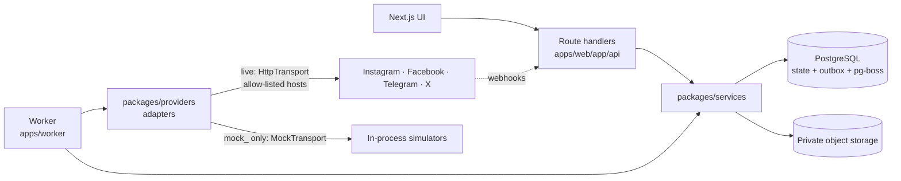

# Architecture (as implemented)

Modular monolith: one repository, two runtime processes (web, worker), PostgreSQL for state **and** the durable queue, S3-compatible object storage for media. No Redis, Kafka or microservices.

## Request path

Every `/api` route goes through `route()` (`apps/web/lib/api.ts`): session cookie → Origin + `X-CSRF-Token` on mutations → active-workspace membership → `Ctx`. Services enforce roles (`packages/core/permissions.ts`), brand grants and `workspace_id` on every query; cross-tenant IDs return 404. Composite foreign keys `(workspace_id, id)` make cross-tenant rows impossible at the database level.

## Content model

- `posts.draft` — mutable working copy, autosaved with `version` (optimistic concurrency).
- Submit / schedule / publish snapshots it into an immutable `post_revisions` row plus one immutable `variants` row per destination (DB triggers forbid updates). Unchanged content reuses the latest revision.
- `schedules` — one live schedule per post (`generation` increments on every reschedule/edit; partial unique index). Stores the UTC instant **and** the IANA zone, original wall time and chosen offset.
- `approvals` — bound to revision + schedule fingerprint (revision, destinations, time, deadline). Any change invalidates it; the worker re-checks it at dispatch.

## Publishing pipeline

1. **Schedule transaction**: idempotency key → authorise → validate every destination → snapshot revision → supersede old schedule → insert schedule + deliveries + outbox `delivery.due` rows. All or nothing.
2. **Outbox dispatcher** (worker): moves outbox rows to pg-boss with a deterministic job id (UUIDv5 of the outbox id). A crash between enqueue and marking re-sends the same id; pg-boss ignores the duplicate.
3. **Claim** (`engine/claim.ts`): `SELECT … FOR UPDATE SKIP LOCKED`, one active claim per connection, throttled connections and open provider circuits skipped. The claim sets a 90 s lease and increments a **fencing token**; every later write must match it. Two paths claim work: the pg-boss fast path and a due-work loop, so a lost wake-up only delays publication.
4. **Gate** (rechecked before preparing and again before sending): schedule generation, cancellation, deadline, workspace/brand/account pause, account status, mock/live identity, approval.
5. **Prepare** (safe to repeat; e.g. Instagram container, X media upload) — checkpointed on the delivery so restarts resume.
6. **Send**: an atomic fenced transition to `publishing/sending` (budget consumed here). Cancellation is guaranteed only before this point.
7. **Outcome** → state: `confirmed`→Published, `processing`→Processing (polled), `rejected_safe_to_retry`→RetryWait/Failed/Expired, `permanent_failure`→Failed or Blocked (account flagged), `unknown`→**Unknown**.
8. **Sweepers**: expired lease in `preparing` → requeued; expired lease in `sending` → Unknown (never resent). Past publish-before → Expired.
9. **Reconciliation**: Unknown deliveries are checked read-only with the provider (`adapter.reconcile`). Found → Published; confirmed absent → Failed (retry safe); unsupported (Telegram) → manual resolution. Manual retry of Unknown requires explicit duplicate-risk acknowledgement and is audited.

States: `scheduled, preparing, publishing, processing, retry_wait, published, failed, blocked, paused, cancelled, expired, unknown` (`packages/core/state-machine.ts`).

## Providers

`PublishingAdapter` (`packages/core/adapter.ts`): `capabilities · validate · prepare · publish · reconcile · health · refreshCredentials`. The registry returns `MockTransport` **only** for `is_mock` connections whose ID starts with `mock_` and only when mock providers are enabled; live connections always get `HttpTransport` (HTTPS, allow-listed provider hosts, no redirects, timeouts classified by whether the request may have been sent). See [PROVIDER_CAPABILITIES.md](PROVIDER_CAPABILITIES.md).

## Security

- Credentials: envelope encryption (AES-256-GCM data key per secret, wrapped by a KEK from `KEY_ENCRYPTION_KEYS` / KMS), purpose-bound AAD, never returned to clients. Refresh is serialized per connection with an advisory lock.
- Sessions: opaque token (SHA-256 stored), HttpOnly, SameSite=Lax, `__Host-` + Secure in production, 12 h absolute / 2 h idle.
- OAuth/OIDC: single-use hashed state, 10 min expiry, PKCE, nonce, bound to the initiating user.
- Media: presigned POST with size range → type sniffing → full decode with a pixel cap → metadata stripped → derivatives; originals never served; short-lived signed URLs only after authorisation.
- Logs redact tokens, token-bearing URLs (incl. Telegram `/bot<token>/`) and secret-named fields.
- Production refuses to start with mock providers, the dev identity provider, insecure HTTP, local storage/email defaults or the dev KEK.

## Observability

Structured JSON logs; `worker_heartbeats`; `/api/health`, `/api/ready`, worker `:3001/health|ready`; `/api/ops` (queue age, outbox backlog, heartbeats, live vs simulated success rates with denominators, dispatch lateness p50/p95, circuits, usage, alerts).
