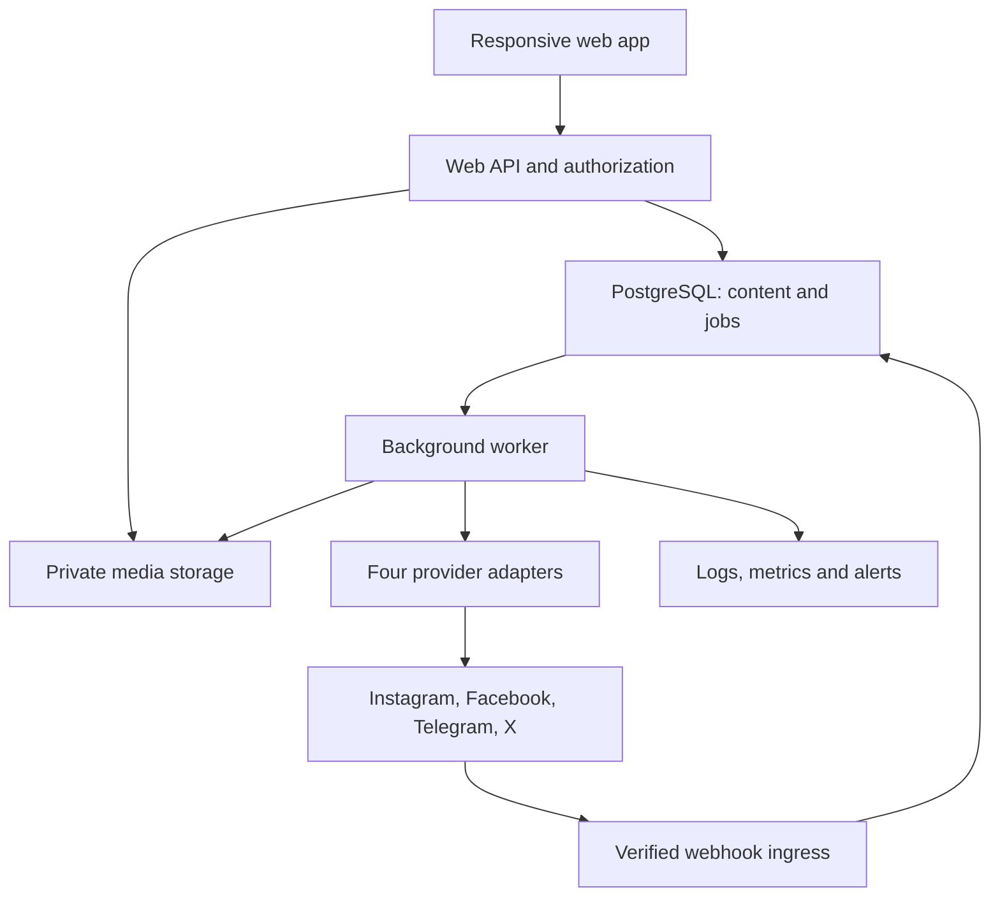
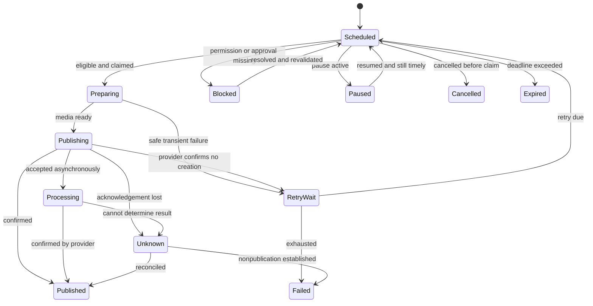

# Social Lite — Product Specification and System Design

Version 1.0 • 6 November 2026 • Planning specification, not an implemented system

Working name: Social Lite. Final product name and domain are undecided.

## 1. Product decision

Build a lightweight social publishing application for Instagram, Facebook, Telegram and X/Twitter. A user creates a post once, adjusts it for each channel, schedules it and sees exactly which destinations published successfully. Organise multiple brands without mixing their accounts, assets or credentials.

Start with Vitalos and TipSignal as potential internal users, but keep the product generic. TipSignal is an optional content integration, not the application’s data model. No connection to Hootsuite is needed. The Hootsuite shared secret and webhook obtained earlier are not inputs to this standalone product; the existing Telegram bot can be connected after its permissions and ownership are verified.

The product should feel small: a calendar, composer, media library, account connections and delivery history. Its publishing engine must nevertheless handle failed requests, expired permissions, duplicate jobs and uncertain provider responses correctly.

### Confirmed and assumed

| Item | Decision |
|---|---|
| Confirmed platforms | Instagram, Facebook, Telegram, X/Twitter |
| Confirmed direction | Lightweight Hootsuite-style application |
| Initial users — assumption | Owner and a small invited team managing several brands |
| Business model — assumption | Internal use first; paid customer workspaces later |
| Delivery — assumption | Responsive web application; no native mobile app |
| Deployment — proposal | Small always-on application host, managed PostgreSQL and object storage |
| Budget | Not supplied; estimates below are planning allowances |
| Autonomy | AI drafts; a person approves or schedules publication |
| Scope boundary | Publishing first; full social inbox and listening are later options |

These assumptions are reversible planning decisions. Infrastructure provisioning, spending and real social posts are not performed by this specification.

## 2. Hootsuite website review and implications

Review basis: public marketing, publishing, analytics, Nest and pricing pages, plus documentation for its custom messaging integration. No authenticated product trial, usability test or verification of Hootsuite’s internal architecture was performed.

| Observed Hootsuite area | What Social Lite should take from it | Deliberate reduction |
|---|---|---|
| Publishing: composer, calendar, scheduling, approval and bulk workflows [S1] | One planner, per-channel variants, clear review and delivery states | Small imports; one review stage |
| Analytics: post/account reporting and exports [S2] | Delivery health first; available platform metrics later | No attribution or paid-ad reporting at launch |
| Nest: social messaging and customer care [S3] | Account-aware permissions and a future conversation adapter | No unified inbox in first release |
| Broader suite: listening, AI and employee advocacy [S4] | Assist drafting and preserve a modular boundary | No listening engine, advocacy suite or competitor scraping |
| Pricing packages combine accounts, collaboration and advanced tools [S5] | Model account and usage limits explicitly | No billing implementation for internal launch |
| Custom profiles connect external messaging to Inbox [S6] | Keep publishing and messaging as separate capabilities | Do not use its webhook as a publishing dependency |

This is an independent design inspired by workflows, not a copy of Hootsuite’s branding, visual assets or implementation. Hootsuite’s breadth is not the target scope.

## 3. Outcomes and success measures

1. Connect the four supported channel types and verify destination ownership/permissions.
2. Schedule a graphic and channel-specific copy in one workflow.
3. Publish while the user’s browser is closed.
4. Prevent duplicate sends caused by repeated clicks and ordinary queue redelivery.
5. Display partial success honestly and retry only eligible failed destinations.
6. Explain what needs attention without requiring the user to interpret raw API errors.
7. Keep brands separate and provide an audit trail of publication decisions.

Pilot acceptance targets, to measure rather than advertise as guarantees:

| Measure | Target |
|---|---|
| Initial planning capacity | 5 workspaces, 25 brands, 100 connected destinations |
| Daily load | 1,000 destination publications/day; load test 100 due in the same minute |
| Dispatch latency | 95% of eligible due jobs begin within 60 seconds under design load |
| Visibility | Persisted state change appears in the UI within 10 seconds |
| Reliability | At least 99% of eligible attempts succeed within five minutes during pilot, separately report provider-caused failures |
| UI | Calendar API p95 under 500 ms for a normal one-month query; interactive page target under 2.5 s on a representative mobile connection |
| Recovery | Database RPO target ≤1 hour and service RTO ≤4 hours, only after backup/restore capability is verified |

“Eligible” excludes paused, expired, invalid, unauthorized or provider-throttled jobs. Publish both the eligible metric and an unfiltered user-facing success rate to avoid hiding failures. Start-time targets do not promise that provider video processing completes within 60 seconds.

## 4. Release scope

### MVP: four-channel publishing

- Sign in, invite team, workspace and brand isolation.
- Connect Instagram professional accounts, Facebook Pages, Telegram channels and X accounts.
- Shared composer with per-destination copy, image selection and previews.
- Text/link publishing where supported; single-image publishing across all four.
- Instagram requires media: text-only drafts cannot be scheduled to it.
- Draft autosave, templates, tags and a small image library.
- Calendar and list views; immediate and scheduled publication.
- Optional single-stage approval per brand.
- Delivery history, account health, safe retry and emergency pause.
- Workspace time zone and explicit daylight-saving handling.
- Operational dashboard and CSV export of publishing history.

The first engineering milestone can be Telegram-only, but the MVP is not complete until live, authorized publishing is verified for all four platforms. If Meta approval or X access is unavailable, label the release a limited pilot rather than claiming four-platform completion.

### V1.1: richer media and productivity

- Instagram carousels/Reels, Facebook video/Reels, Telegram albums/video, X multi-image/video, each behind passing capability tests.
- CSV import, content queues, reusable posting slots, image crops, brand templates.
- AI caption assistance, approved-source repurposing and per-platform rewriting.
- Provider analytics and tracked link clicks where supported and authorized.
- Optional TipSignal draft ingestion and deterministic graphic generation.

### V1.2 / commercial expansion

- Selected comments/replies and conversations, with independent network permission review.
- Customer billing, quotas, onboarding and workspace lifecycle.
- Client approval links, reports and public integration API.

### Explicit exclusions

No paid-ad buying, broad social listening, follower scraping, automated likes/follows, social account passwords, browser-based API bypasses, native apps, image-generation infrastructure, universal DM access, or enterprise approval trees. Stories and live streams are excluded until independently specified and tested. Scheduled publication is not automatically a recurring post.

## 5. Platform capability and access design

| Platform | Supported destination | MVP formats | Connection | Main gate |
|---|---|---|---|---|
| Instagram | Professional business/creator account | Single image and caption | Meta authorization; proposed Facebook Login route with linked Page | Account eligibility, permissions and production access |
| Facebook | Page | Text, link or single image | Meta authorization and selected Page | Page role/tasks and required permissions |
| Telegram | Channel where bot may post | Text, link or photo/caption; optional URL button | Bot token plus verified channel ID | Bot administrator posting permission |
| X/Twitter | Authorized user account | Text, link or single image | User-context OAuth | Developer app, write/media access and API funding |

Meta’s official Instagram collection confirms the professional-account requirement and linked Page for the Facebook Login route [S7]. A separate Instagram Login route may be added later; do not accidentally apply the linked-Page requirement to every possible Instagram integration. For MVP, use one documented login route to reduce complexity.

Facebook personal profiles and Groups are not promised destinations. Meta’s official Facebook collection was located [S8], but parts of its developer site returned access/rate-limit errors during this review. Exact permission sets, current Graph version, publishing endpoints and review requirements must be verified in the implementation access spike; they are not claimed as already tested.

Telegram supports bot-based message and media publication [S9]. Use numeric channel identifiers internally, represented as strings at API boundaries. A private channel invite link is not a channel ID. Do not assume a bot can retrieve historical channel analytics or every subscriber conversation.

X requires user authorization for posting; its official documentation describes post creation and media upload [S10]. Its developer site currently describes usage-based API billing [S11]. Exact endpoint pricing, media authorization and quota availability must be captured from the project’s developer console before launch. API read costs can exceed publishing costs, so polling has a budget limit.

### Access-spike deliverable for each platform

Record app identifier, environment, granted scopes, account type, token expiry/refresh behaviour, supported formats, rate limits, media constraints, approval status, version and date checked. Perform an authorized test post and record its provider ID and visible result. Test denied permissions and revoke/reconnect behaviour. Test deletion only on a designated disposable test post.

Expose a capability record per destination, not a hard-coded universal list:

```ts
type ChannelCapabilities = {
  provider: 'instagram' | 'facebook' | 'telegram' | 'x';
  formats: Array<'text' | 'image' | 'album' | 'video' | 'reel'>;
  canPublish: boolean;
  canEditPublished: boolean;
  canDeletePublished: boolean;
  canReadMetrics: boolean;
  constraintsVersion: string;
  checkedAt: string;
};
```

The adapter supplies detailed length, MIME, dimensions, aspect ratio, file-size and rate constraints. Validate on composing, scheduling and dispatch. Pin the provider API version where supported; use fixtures and a scheduled compatibility review before changing it.

## 6. Roles, workspace and brand boundaries

A workspace is the tenant. A brand belongs to one workspace. Connected accounts, posts and assets belong to a brand. Users receive workspace roles and optional brand restrictions.

| Action | Owner | Admin | Editor | Approver | Viewer |
|---|---|---|---|---|---|
| Manage ownership/billing/delete workspace | Yes | No | No | No | No |
| Invite users and connect accounts | Yes | Yes | No | No | No |
| Create/edit drafts | Yes | Yes | Yes | No | No |
| Approve/reject | Yes | Yes | No | Yes | No |
| Schedule/publish | Yes | Yes | Only if brand policy permits | Only approved content | No |
| Emergency pause | Yes | Yes | No | Yes | No |
| Read allowed brand history | Yes | Yes | Yes | Yes | Yes |

Permissions are enforced server-side for every resource, including media URLs and exports. Admins cannot silently change an owner. Invitations expire and bind to the intended email. Membership removal blocks new actions immediately and removes authorization to unapproved drafts; previously approved schedules remain unless policy explicitly cancels them. Show this consequence in the removal flow.

## 7. Navigation and screens

Use an original, restrained black/charcoal design with readable neutral surfaces, clear platform icons and one accent colour. Provide light mode if needed for accessibility. Never use colour alone to show state.

| Screen | Main contents | Key actions |
|---|---|---|
| Home | Today’s schedule, blocked jobs, account warnings, recent results | Create post; resolve problem |
| Planner | Week/month calendar and list; brand/account/status filters | Schedule, move, duplicate, pause |
| Composer | Base draft, channel tabs, assets, previews, date/time, review | Save, submit, publish, schedule |
| Approvals | Revision preview and change summary | Approve, reject with comment |
| Library | Assets, templates, tags, usage and upload status | Upload, reuse, archive |
| History | Per-destination results, IDs, links, timestamps and attempts | Inspect, retry safely, export |
| Accounts | Connected destinations and capability/permission health | Connect, reconnect, pause, disconnect |
| Settings | Brand voice, timezone, team, approval policy and budgets | Configure |

Mobile defaults to agenda/list rather than a compressed month grid. Composer uses channel tabs and a sticky save/schedule action; large touch targets, keyboard navigation, visible focus and WCAG 2.2 AA target. Previews are approximate and labelled as such; they cannot guarantee native rendering. Empty, loading, offline, upload-processing, reconnect and partial-failure states must be designed explicitly.

## 8. Functional requirements and acceptance conditions

### Accounts: AC-01 through AC-05

- AC-01: OAuth state is single-use, expiring and bound to the initiating user/workspace; use PKCE where the flow supports it.
- AC-02: Fetch available destinations and let the user explicitly choose; importing all managed Pages is not automatic.
- AC-03: Telegram setup accepts a token through a protected server endpoint; verify bot identity, destination identity and posting rights before marking ready.
- AC-04: Display Ready, Missing permission, Expiring, Reconnect required, Paused or Disconnected. A connection is never Ready merely because a token was saved.
- AC-05: Disconnect prevents new dispatch and blocks queued work; reconnecting a different provider identity creates a new connection rather than silently redirecting old jobs.

For Telegram, use a dedicated bot where practical. Do not overwrite an existing bot webhook during outbound-only setup. Publication does not require taking ownership of its incoming update stream. If channel-ID discovery needs updates, inspect the current webhook and use an explicit onboarding method that preserves existing bot integrations.

### Composer: CO-01 through CO-08

- CO-01: One conceptual post has one or more destination variants. Each variant may override copy, media crop, links and supported buttons.
- CO-02: Autosave after a short debounce; show Saved/Saving/Failed. Use optimistic concurrency to prevent one editor overwriting another.
- CO-03: Clearly mark inherited text versus custom text. Editing base text updates only variants still set to inherit.
- CO-04: Validate each destination independently; errors identify the channel and the exact fix.
- CO-05: Previews use safe rendering. Count text using platform-aware rules, including Unicode and URL handling; do not use JavaScript string length as a universal limit.
- CO-06: Media must be processed and ready before scheduling. Schedule transaction validates ownership and immutable asset references.
- CO-07: MVP allows one image per destination. Do not silently truncate long captions or split posts into threads.
- CO-08: Publish now shows selected destination identities and exact variants. It creates the same durable delivery jobs as scheduling.

### Scheduling: SC-01 through SC-08

- SC-01: Store an absolute UTC instant plus the selected IANA zone and original wall-clock input. Default to Europe/London for the initial workspace.
- SC-02: Reject nonexistent daylight-saving times; ambiguous times require selection of the intended offset. Browser timezone never silently changes the schedule.
- SC-03: Workspace timezone changes affect new defaults and display, not existing UTC schedules. Recurring slots, if added, use explicit wall-clock recurrence rules.
- SC-04: Calendar drag rescheduling shows the new time and requires a confirmed save, with a short undo window before dispatch where possible.
- SC-05: Pausing a workspace, brand or connection is checked at dispatch, not only when enqueueing.
- SC-06: Every schedule may have a publish-before deadline. Default overdue grace is 15 minutes; time-sensitive content must use a stricter deadline where appropriate.
- SC-07: After outage, show missed jobs for review; never dump all expired posts into a channel.
- SC-08: Edits or rescheduling create a new immutable revision/schedule generation. Old queue items become harmless no-ops.

### Approval: AP-01 through AP-04

- AP-01: Brand setting enables one approval step; owner-only brands may disable it.
- AP-02: Approval binds the complete content revision, destinations, assets, links and schedule. Any change invalidates approval.
- AP-03: A reviewer sees the exact outgoing variants and meaningful diff; rejection requires a reason.
- AP-04: A dispatcher independently checks approval. UI state cannot bypass it.

### Media: ME-01 through ME-05

- ME-01: Upload directly to private object storage with a short-lived, size-limited upload authorization.
- ME-02: Verify real MIME, decode images, reject malformed/polyglot content and bound dimensions to prevent decompression abuse. Sanitize metadata and generate previews.
- ME-03: Quarantine until validation finishes. Reject executable formats and SVG for MVP; support validated JPEG/PNG with provider-specific derivatives.
- ME-04: Keep immutable originals and named derivatives. Generate provider-fetchable signed URLs just before upload/publication; their TTL must cover provider fetch/processing and retries. Do not expose the bucket publicly.
- ME-05: Prevent deletion of assets referenced by scheduled jobs. Archive first; physical deletion follows retention and reference checks.

### Delivery and history: DE-01 through DE-05

- DE-01: Show successful, failed, blocked, processing and unknown results separately for each destination.
- DE-02: Three successful channels and one failure display Partial success. Retry never resends the three successful ones.
- DE-03: Store provider IDs, attempt timestamps, actor, content revision and safe error messages. Never log credentials or token-bearing request URLs.
- DE-04: Downloadable history includes destination and original scheduled/published times, not merely a parent post success flag.
- DE-05: Editing/deleting already-published content is capability-dependent and not implied by deleting a local draft. MVP links to the native post for unsupported operations.

## 9. System architecture

### Recommended baseline

Use a modular monolith with two runtime processes from one repository: web/API and background worker. PostgreSQL holds business state and the durable job queue. Object storage holds media. A worker runs continuously, independently of browser sessions and web request lifetimes.

Proposed stack: TypeScript; Next.js/React for web and authenticated API; Tailwind with accessible component primitives; a managed OIDC identity provider; PostgreSQL with migrations; a supported Postgres-backed durable job library such as pg-boss; S3-compatible object storage; Docker; structured logs and error monitoring. Select supported stable releases and pin lockfiles during implementation. Library choices here are design proposals, not claims about tested package compatibility.



Application modules: identity, tenancy, brands, connections, credentials, content, approval, scheduling, media, delivery, reporting and optional AI. Shared provider contracts keep API-specific behaviour out of the composer and scheduler.

No Kubernetes, Kafka, Redis or independently deployed microservices are needed initially. Add a separate media worker only when video workloads justify it. Do not add a new distributed service to solve a problem PostgreSQL already handles at this scale.

### Scheduling source of truth

Our database is authoritative for all four networks. Do not simultaneously schedule the same post through a provider’s native future-publication mechanism. The worker invokes the provider near the due time. Media preparation can occur earlier only where provider expiry rules permit it. Store preparation IDs and expiry; create fresh preparations when necessary without duplicating final publication.

## 10. Data model and database invariants

All tenant-owned rows contain workspace_id. Brand-owned rows also contain brand_id. Use composite foreign keys or equivalent enforced constraints to prevent cross-tenant relationships. Tenant checks occur in service queries, with row-level security as defence in depth if implemented and tested with the actual connection pool/transaction model.

| Entity | Important fields and purpose |
|---|---|
| workspaces | id, name, timezone, state, publishing_paused, limits |
| memberships | workspace_id, user_id, role, optional brand grants |
| brands | workspace_id, name, timezone, approval_policy, pause flag, voice settings |
| connections | brand_id, provider, provider_account_id, display_name, status, capabilities, credential_ref |
| credentials | workspace_id, encrypted_blob, key_version, expires_at, granted_scopes, refresh_version |
| assets | brand_id, object_key, MIME, checksum, bytes, dimensions, status, retention_at |
| asset_derivatives | asset_id, variant, object_key, transform_version, verified metadata |
| posts | brand_id, creator_id, current_revision_id, archive state, tags |
| post_revisions | post_id, revision_number, base text, creator, created_at; immutable |
| variants | revision_id, connection_id, rendered text, format, media refs, links, options |
| approvals | revision_id, schedule_generation, reviewer_id, decision, time, reason |
| schedules | post_id, revision_id, generation, due_at, input_timezone, input_local_time, deadline, status |
| deliveries | schedule_id, variant_id, connection_id, state, next_attempt_at, lease/fence, provider IDs |
| delivery_attempts | delivery_id, attempt_number, phase, start/end, outcome, safe code, request correlation |
| outbox | aggregate_id, event_type, payload_version, dispatch state, available_at |
| webhook_receipts | provider, connection_id, external_event_id/digest, received_at, processing state |
| audit_events | workspace_id, actor/service, action, resource, safe diff, timestamp |
| notifications | user_id, severity, reference, dedupe key, read/sent status |
| metric_snapshots | connection/post reference, metric, value, observed_at, window, source; V1.1 |
| ai_usage | workspace_id, model, task, tokens/cost estimate, revision reference; V1.1 |

Essential constraints and indexes:

- Unique connection identity within its intended ownership boundary; cross-workspace reuse is explicit, not accidental.
- Unique revision number per post; unique variant per revision and destination.
- Unique delivery per schedule generation and variant.
- Unique API idempotency key per workspace/action, storing request hash and response.
- Unique provider event receipt where event IDs exist; content digest fallback includes provider and destination context.
- Due-job partial index on state and next_attempt_at; calendar index on workspace_id, brand_id, due_at.
- Foreign-key and asset-reference validation in the scheduling transaction.
- Provider IDs stored as text; timestamps stored with timezone semantics.
- Cursor pagination for history and event tables. No unbounded calendar or media queries.

Published content remains attached to its immutable revision, even when the parent draft changes. Provider metrics retain their native definitions and observation times; unavailable is NULL/unsupported, never fabricated zero.

## 11. Durable publishing algorithm

1. Client submits schedule with revision, destinations, time, expected version and idempotency key.
2. Server authorizes the user, validates variants, assets, destination health, approval and deadlines.
3. One database transaction writes schedule, destination deliveries and outbox events. A committed schedule must never depend on a non-transactional queue call succeeding.
4. An outbox dispatcher enqueues deterministic job IDs and marks the outbox entry after acknowledgement. Duplicate enqueue is safe. A sweeper repairs undispatched entries.
5. At due time, a worker atomically claims a delivery and sets a lease plus fencing generation. It rechecks pause, account identity, schedule generation, approval and deadline.
6. A short transaction records preparation/attempt intent. External network calls run outside long-lived DB transactions. Heartbeat while work continues.
7. Adapter performs media preparation, polls asynchronous preparation where needed, then publishes. Persist each recoverable checkpoint.
8. On acknowledged creation, persist provider ID(s) and response status; asynchronous provider acceptance stays Processing until confirmation where the API distinguishes it from publication.
9. On safe failure, apply retry policy. On an ambiguous publication outcome, move to Unknown and reconcile instead of automatically resending.
10. Aggregate status derives from destination states. Emit history/notification events through the outbox.

Exactly-once external publication cannot be guaranteed universally. A provider can create a post while the response is lost. Database idempotency prevents our own duplicate jobs but cannot undo a network ambiguity. Use provider idempotency when supported; otherwise stop and reconcile. Telegram Bot API publication in particular must not be assumed to have a universal client idempotency key or arbitrary historical message lookup.

### Destination state machine



Deadline expiry is checked on every re-entry. Permanent failures can transition from any active step to Failed. Unknown is never equivalent to Failed. Manual retry of Unknown requires explicit duplicate-risk acknowledgement and a new audited attempt; do not hide this behind a general Retry all button.

### Races and leases

Cancellation is guaranteed only before final dispatch claim. Once the outbound request has begun, return “Cancellation requested; publication may already be in progress.” Do not display Cancelled without certainty. An expired lease during a sending phase is treated as potentially ambiguous; a new worker must not simply repeat the send. Fencing prevents stale workers changing database state, but cannot retract an already-sent external request. A returned provider ID from a late worker is retained for reconciliation.

### Error policy

| Condition | Action |
|---|---|
| Invalid content, unsupported format | Fail with exact correction; no automatic retry |
| Expired/revoked token | Refresh once where supported, else block and notify |
| HTTP 429 | Respect Retry-After/provider reset; per-account throttling |
| Known pre-send connection failure | Retry with bounded backoff |
| Explicit provider rejection with transient code | Retry only if documented as safe |
| Timeout/reset after request may have been sent | Unknown; reconcile |
| Media processing pending | Poll status with bounded delay; preserve upload/container ID |
| Provider maintenance | Circuit breaker per provider; respect deadlines |
| X budget exhausted | Block X jobs only; notify; preserve other channel jobs |

Default safe retry schedule: approximately 30 seconds, 2 minutes, 5 minutes and 10 minutes, with jitter; maximum five attempts including initial attempt. Provider instructions and publish-before deadlines take precedence. Bulk campaigns are rate-limited per account and provider; one noisy tenant cannot monopolize workers.

## 12. Provider adapter contract

```ts
interface PublishingAdapter {
  capabilities(connectionId: string): Promise<ChannelCapabilities>;
  validate(input: PublishInput): Promise<ValidationResult>;
  prepare(input: PublishInput, checkpoint?: Checkpoint): Promise<Preparation>;
  publish(input: PublishInput, preparation: Preparation): Promise<PublishOutcome>;
  reconcile(attempt: AttemptReference): Promise<ReconcileOutcome>;
  health(connectionId: string): Promise<ConnectionHealth>;
}
// PublishOutcome is a discriminated union:
// confirmed | processing | rejected_safe_to_retry | permanent_failure | unknown.
// Optional methods: refreshCredentials, fetchMetrics, edit, delete.
```

Provider notes: Instagram needs preparation/container status handling before publication. Facebook uses the appropriate Page endpoint for the selected format. Telegram sends message/photo using the chosen channel and saves every returned message ID. X uploads media then references its media ID when creating a post. Details are adapter-owned and validated against current official documentation, not copied into core scheduling logic.

## 13. Internal API contract

Use JSON HTTP endpoints with server-side session auth. Mutation requests require CSRF/origin protection as appropriate, an idempotency key for creation/publishing and an expected version for edits. Error responses include code, readable message, field errors and correlation_id; never raw secrets/provider responses.

| Method/path | Behaviour |
|---|---|
| GET /api/workspaces/:id/brands | Authorized brand list |
| POST /api/brands/:id/connections/:provider/start | Begin scoped connection flow |
| GET /api/oauth/:provider/callback | Verify state and finish server-side authorization |
| POST /api/brands/:id/connections/telegram | Protected token and destination verification |
| GET /api/connections/:id/health | Safe metadata and capabilities |
| POST /api/assets/upload-intent | Issue bounded upload authorization |
| POST /api/assets/:id/complete | Start validation; verify stored bytes |
| POST /api/brands/:id/posts | Create draft and initial revision |
| PATCH /api/posts/:id | Create new revision with expected_version |
| POST /api/posts/:id/validate | Validate every selected variant |
| POST /api/posts/:id/submit | Submit specific revision for review |
| POST /api/posts/:id/approve | Approve exact revision/schedule generation |
| POST /api/posts/:id/schedule | Atomically schedule variants |
| POST /api/posts/:id/publish | Same pipeline with immediate due time |
| POST /api/schedules/:id/cancel | Cancel pending delivery safely |
| POST /api/deliveries/:id/retry | Authorized state-aware retry |
| GET /api/planner | Bounded UTC range and filters |
| GET /api/posts/:id/deliveries | Per-target state and attempt history |
| POST /api/brands/:id/pause | Pause dispatch for the brand |
| POST /api/webhooks/:provider | Authenticate, deduplicate, persist, acknowledge |

Example schedule request:

```json
{
  "revision_id": "revision_uuid",
  "expected_version": 7,
  "connection_ids": ["instagram_uuid", "facebook_uuid", "telegram_uuid", "x_uuid"],
  "scheduled_at": "2026-11-10T09:00:00Z",
  "timezone": "Europe/London",
  "input_local_time": "2026-11-10T09:00:00",
  "publish_before": "2026-11-10T09:15:00Z"
}
```

Return 202 with schedule_id and four delivery records. Repeated idempotency key plus identical payload returns the original result; changed payload returns conflict. Scheduling succeeds atomically for all selected valid destinations; if one is invalid, ask the user to fix or explicitly deselect it. Delivery after scheduling is necessarily independent per provider.

## 14. Security, data and operations

Encrypt provider credentials using envelope encryption with keys managed outside the database. Store secret references in normal rows; decrypt only in the narrow publishing/refresh path. Apply least-privilege service identities, TLS, secure HttpOnly session cookies, rate limits and audit records. Never put provider credentials into browser storage, URLs, analytics or error tracking. Telegram’s token-bearing API path must be redacted before HTTP logging.

Serialize refresh per connection to avoid invalidating rotating refresh tokens. Reauthorize cleanly on revocation. Credentials and private assets are not AI prompt inputs. Webhook signatures/secret verification are provider-specific; verify the raw body when required, enforce replay rules where available and persist/deduplicate before acknowledging.

Protect media fetching against SSRF: prefer owned uploaded objects; otherwise allow only approved public HTTPS hosts, block private/link-local/cloud metadata destinations, validate DNS and redirects at every hop and enforce size/time budgets. Do not expose an arbitrary URL fetch proxy.

Proposed retention: drafts until deleted, delivery/audit metadata 12 months, raw webhook bodies up to 7 days when required for debugging, ordinary logs 30 days. These are product defaults, subject to platform retention obligations and the eventual privacy policy. Delete unused assets after 30 days in trash. Delete disconnected credentials immediately unless a documented temporary reconnect workflow requires encrypted retention. Provider deletion callbacks and account data deletion requests must be implemented before external customer onboarding.

Log IDs and safe categories rather than full post contents by default. Alerts: queue oldest age, worker heartbeat missing, outbox backlog, unknown outcome, repeated auth failure, high failure rate, database saturation, backup failure and budget threshold. Alert dedupe prevents one invalid token producing hundreds of emails.

Daily runbook: inspect blocked/unknown jobs, upcoming expiring connections and storage/budget. Incident runbook: pause affected scope, preserve evidence, diagnose, reconcile ambiguous sends, resume only timely jobs. Restore runbook: restore database into isolation, keep all dispatch disabled, reconcile jobs around the recovery boundary against provider results before reenabling. Restoring an old database can otherwise republish posts already sent.

## 15. Deployment and cost design

### Initial deployment proposal

One small Linux host runs reverse proxy, web/API and worker containers with restart policies. PostgreSQL is managed separately with tested recovery. Media lives in managed object storage, not on the application disk. Use a managed identity service and transactional email provider. Staging has separate database, secrets, bucket prefixes and dedicated test destinations.

CI runs type checks, lint, relevant tests, migration checks and image builds. Deploy by immutable image digest; make schema changes backward compatible with both versions during rollout. Run migrations as one controlled job. Drain workers before replacement. Roll back application images without destructive database rollback.

If choosing GCP, map the host to Compute Engine, database to Cloud SQL, objects to Cloud Storage and credentials to Secret Manager. If instead choosing Cloud Run, redesign worker execution explicitly around authenticated task requests and durable queue/outbox dispatch; a request-scaled container with an in-process timer is not a reliable scheduler. GCP has not been provisioned for this new project.

### Planning allowance, not a supplier quote

| Component | Estimated monthly allowance |
|---|---:|
| Small always-on app/worker host | £10–£30 |
| Managed PostgreSQL and recovery | £20–£60 |
| Object storage, transfer and backups | £2–£15 |
| Email, basic monitoring, identity | £0–£20 at small usage |
| Total infrastructure allowance | £32–£125 |
| Optional AI allowance | £5–£25, capped |
| Social API charges | Separate, especially X; verify account-specific pricing |

These estimates exclude development, VAT, domain, heavy video traffic, HA database premiums and social API charges; an all-GCP configuration may exceed the range depending on region and database sizing. Official Cloud SQL pricing varies by configuration and region [S12]. Use a supplier calculator before committing. Do not select a plan based on a free-tier assumption.

Cost model: fixed infrastructure + stored GB + outbound media GB + provider write/read charges + AI tokens. Set per-workspace monthly caps and alerts at 50/80/100%. At a hard API budget limit, stop affected chargeable jobs with a clear reason rather than silently overspending or falsely reporting success.

## 16. AI and TipSignal integration

AI is an assistive feature after reliable publishing works: shorten captions, adapt tone, create platform variants, suggest hashtags and repurpose an approved source. It returns structured draft suggestions; the user sees a diff and chooses what to accept. A model never receives a general credential or direct publish tool. Content loaded from URLs is untrusted text, not instructions. Limit input length and use SSRF-safe retrieval.

Brand configuration: tone, approved terminology, prohibited phrases, default CTA, hashtags and optional required footer. For TipSignal specifically, preserve exact match names, dates, market, probability and settled result from validated inputs; do not let a model manufacture probabilities or results. Probability is not a promise of winning. Keep the source link and record ID.

Optional inbound endpoint accepts signed, timestamped, schema-versioned events such as picks.ready and results.settled. Deduplicate on source event ID and create a draft, not an automatic post by default. Bind events to the configured brand; reject arbitrary destination overrides. Use an expiry before kick-off for picks, and verify settlement before results content. Failed/retried events cannot create duplicate drafts.

For reusable result graphics, use a deterministic SVG/HTML template renderer with validated data and export images. Exact scores, probabilities and typography should not depend on image generation. A preapproved automation policy may later schedule drafts within explicit destination/time/content bounds, with a kill switch and complete audit trail.

## 17. Analytics specification

MVP analytics are fully owned operational facts: scheduled count, published count, per-channel success, failure categories, lateness, retries and time saved only if actually measured. Show periods, denominators and last refresh.

V1.1 may add native engagement/reach metrics, depending on granted access. Store raw metric identity, period, timestamp and source. Do not sum cross-network reach as unique people or treat Telegram delivery confirmation as a view count. Different networks’ engagement rates are not directly comparable without a stated formula. For supported metrics, cache and batch reads within budget; default pilot refresh daily and on-demand with throttling.

Owned redirect links can measure clicks later, with bot filtering, privacy controls and retention. An Instagram caption URL is not presented as a guaranteed clickable CTA. Always distinguish app-observed clicks from network-reported metrics.

## 18. Test strategy and release gates

| Test | Required result |
|---|---|
| User in workspace A requests B’s post, asset or credential | Denied; no existence/secret leakage |
| Four-channel image scheduled | Four provider-specific validations and live authorized publication records |
| Instagram selected for text-only post | Clear blocking error before scheduling |
| Publish double-click / same request replay | One schedule and one delivery per destination |
| Two workers claim same job | Only one owns valid dispatch claim |
| Crash after provider created post, before DB commit | Unknown/reconciliation; no blind resend |
| One provider fails after other three succeed | Partial success; successful posts are untouched |
| Token expires or bot loses admin permission | Blocked/reconnect state and notification |
| Pause then due job arrives | No dispatch after pause boundary unless request already in flight |
| Edit/cancel while worker claims | Deterministic generation check and honest outcome |
| DST gap/fold in Europe/London | Rejection or explicit offset choice; correct UTC |
| Worker outage exceeds deadline | Expired/review, no stale flood |
| Malformed media or cross-tenant asset | Rejected/quarantined |
| Malicious URL/private IP redirect | Fetch blocked |
| Approval then text/time/media changed | Approval invalidated |
| Duplicate/out-of-order webhook | Idempotent handling; state cannot regress |
| Rate limit or X budget exhausted | Controlled delay/block, other providers continue |
| Database restored from backup | Dispatch off until reconciliation; no replay storm |
| 100 jobs due in one minute | Measure latency/fairness with provider mocks and configured limits |
| Mobile composer and keyboard workflow | Usable without horizontal scrolling or pointer-only actions |

Use unit tests for state transitions, validation and authorization; real PostgreSQL integration tests for queue/outbox/concurrency; adapter contract tests with recorded, redacted fixtures; browser tests for critical user flows; a small authorized live canary suite for every supported platform. Mock success is not a substitute for live access verification. Never stress-test social networks with hundreds of real posts.

Release gate: all four adapters demonstrate required formats, restore drill completed, critical tests pass, no unresolved duplicate-send failure, no exposed credentials, pause and reconnect tested, operating costs reviewed, and runbooks assigned. External SaaS launch additionally requires verified platform production access, privacy/deletion processes, tenant limits and support ownership.

## 19. Delivery plan and dependency graph

Estimate: approximately 5–7 focused engineering weeks for one experienced developer, excluding unpredictable provider review delays. A polished video-capable SaaS release is larger. API application work begins on day one.

| Milestone | Deliverables | Exit evidence | Approximate effort |
|---|---|---|---|
| M0 — access and decisions | Four provider apps/access checks, test accounts, capability register, deployment choice | Authorized test publication per accessible provider; blocker log | 2–4 days plus external review |
| M1 — foundation | Auth, tenancy, brands, secrets, assets, draft model | Tenant/credential tests and working draft upload | 4–5 days |
| M2 — publishing engine | Outbox, worker, state machine, Telegram adapter, failure UI | Schedule while browser closed; restart/ambiguity tests | 4–5 days |
| M3 — remaining adapters | Facebook, Instagram, X; refresh and rate limits | Live per-platform image/text evidence as applicable | 5–8 days |
| M4 — product workflow | Composer variants, calendar, approval, history, pause | End-to-end four-channel schedule and partial failure recovery | 4–5 days |
| M5 — hardening and pilot | Monitoring, restore, mobile QA, load, deployment/runbooks | Seven-day pilot and acceptance report | 4–6 days |
| M6 — enhancements | Richer media, AI, imports, analytics | Separate feature-specific gates | After MVP |

M0 and foundation implementation can overlap. Live public four-platform launch depends on M0 access completion, even when coding is finished. Do not build a large dashboard before the scheduled-publication engine works.

### Implementation backlog

| ID | Work item | Depends on | Priority |
|---|---|---|---|
| T01 | Register/verify provider access and permissions | — | P0 |
| T02 | Repository, CI, configuration and deployment skeleton | — | P0 |
| T03 | Auth, tenant roles and brand membership | T02 | P0 |
| T04 | Schema, migrations and database invariants | T03 | P0 |
| T05 | Encrypted credentials and connection health | T01,T04 | P0 |
| T06 | Private uploads, validation and previews | T04 | P0 |
| T07 | Immutable drafts and per-destination variants | T04,T06 | P0 |
| T08 | Outbox, jobs, leases and recovery | T04 | P0 |
| T09 | Telegram adapter and timed publication | T05,T07,T08 | P0 |
| T10 | Facebook adapter | T01,T05,T07,T08 | P0 |
| T11 | Instagram adapter and preparation status | T01,T05,T07,T08 | P0 |
| T12 | X adapter, media and usage controls | T01,T05,T07,T08 | P0 |
| T13 | Composer and platform validation | T07,T09–T12 | P0 |
| T14 | Calendar, timezones and rescheduling | T08,T13 | P0 |
| T15 | Review, immutable approval and audit | T03,T07,T14 | P0 |
| T16 | History, errors, pause and reconciliation | T08–T15 | P0 |
| T17 | Monitoring, backup restore and security validation | T02–T16 | P0 |
| T18 | Four-channel pilot and release evidence | T17 | P0 |
| T19 | Media expansion and CSV import | T18 | P1 |
| T20 | AI drafting and optional TipSignal source | T18 | P1 |
| T21 | Provider analytics with quotas | T18 | P1 |
| T22 | Inbox/business model expansion specification | T18 | P2 |

## 20. Decisions before implementation

Defaults to proceed with: internal multi-brand application; all four networks in MVP; Facebook Pages; Instagram professional accounts using the Facebook Login route; one-image MVP; text-only where supported; one-stage optional approval; managed identity; TypeScript modular monolith; Postgres queue; always-on worker; owner-controlled AI drafting.

Need owner selection before provisioning: final name/domain, hosting account and spend cap, exact test/live social destinations, access to provider developer accounts, and whether first release is internal or publicly sold. These are deployment/access inputs, not reasons to delay building the core locally. Never request credentials in a chat message; use the application’s protected connection setup or deployment secret manager.

## 21. Source register and evidence limits

Reviewed 6 November 2026. Source-backed observations are limited to the Hootsuite comparison and provider access notes. The requirements, architecture, estimates and acceptance criteria are proposed engineering decisions. Official documentation and developer-console evidence supersede this snapshot when APIs change.

- [S1] Hootsuite publishing: https://www.hootsuite.com/platform/publishing
- [S2] Hootsuite analytics: https://www.hootsuite.com/platform/analytics
- [S3] Hootsuite Nest: https://www.hootsuite.com/nest
- [S4] Hootsuite suite overview: https://www.hootsuite.com/
- [S5] Hootsuite plans: https://www.hootsuite.com/plans?product=perch
- [S6] Hootsuite custom webchat connection: https://help.hootsuite.com/s/article/connect-webchat
- [S7] Meta-owned Instagram API collection: https://www.postman.com/meta/instagram/documentation/6yqw8pt/instagram-api
- [S8] Meta-owned Facebook API collection: https://www.postman.com/meta/facebook/documentation/r56bjfd/facebook-api
- [S9] Telegram Bot API: https://core.telegram.org/bots/api
- [S10] X official post quickstart source: https://github.com/xdevplatform/docs/blob/main/x-api/posts/manage-tweets/quickstart.mdx
- [S11] X developer platform and usage pricing: https://developer.x.com/
- [S12] Cloud SQL pricing: https://cloud.google.com/sql/pricing

Direct Meta developer pages were partially inaccessible during research. The Facebook permissions/endpoint contract remains an explicit implementation verification gate. No private Hootsuite workflow, social account permission, API billing balance or production deployment has been verified by this document.
