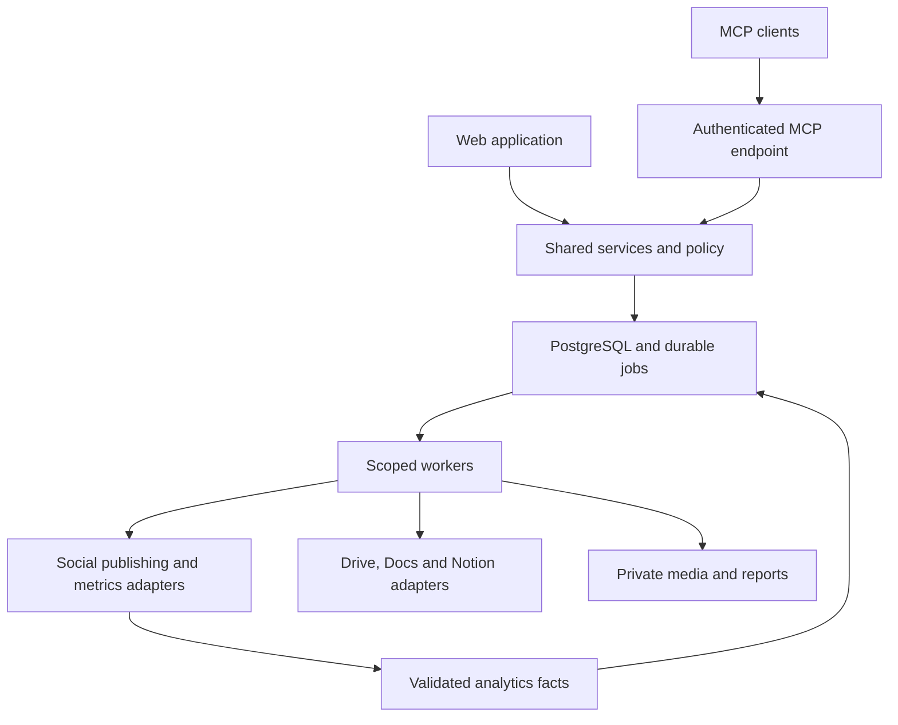

# Social Lite V3 — Modern UI, Advanced Analytics, Expanded Platforms, Content Integrations and MCP

Version 3.0 • 7 November 2026

Paste the execution prompt below into the existing Social Lite coding-agent project. Include the V1 specification, V2 upgrade prompt and supplied screenshots where available. This replaces the V2 execution brief for the next upgrade while retaining its security and collaboration requirements. This document specifies work; it does not claim that the application has been changed or inspected at source level.

## V3 scope at a glance

- Preserve Instagram, Facebook, Telegram and X.
- Add TikTok, YouTube, LinkedIn, Threads, Pinterest and Bluesky through capability-aware integrations.
- Redesign the complete app, including dashboard, composer, planner, library, teams, integrations and analytics.
- Replace horizontal Settings navigation with grouped left-sidebar settings and sub-settings.
- Add Google Drive, Google Docs and Notion as controlled content sources and export destinations.
- Add a first-party MCP server for compatible AI clients, using the same permissions and publishing safeguards as the UI.
- Keep runtime and operational complexity modest. “Lightweight” no longer means visually basic or functionally narrow.

---

# EXECUTION PROMPT

You are the autonomous engineering lead, product designer and release owner for **Social Lite V3**. Upgrade the actual existing application. Inspect its repository and running UI first, then implement, test and repair the work. Do not stop at a design proposal, a static mockup, a scaffold or a collection of disconnected screens.

Make routine implementation decisions without asking me. Use parallel agents where available. Collect external credentials, provider reviews and deployment requirements into one consolidated checklist at the end. Missing credentials must not block independent engineering; implement real integration code and explicit local test transports. Never claim simulated publishing, mocked analytics or a protocol test client as live provider/client verification.

The previous 24-hour sprint preference remains a target for an initial integrated V3 build, not permission to skip requirements or pretend the full expanded scope is finished. All requirements must have implementation/evidence status. If runtime limits prevent completion, preserve a runnable build, precise remaining work and a resumable checkpoint. Do not repeatedly ask whether to continue.

## 1. Preserve and verify the existing foundation

Read project instructions, architecture, migrations, package versions and tests. Establish baseline build and regression results. Use the screenshots as evidence of current presentation, not proof of underlying backend defects. Do not rebuild a sound backend to change the interface.

Preserve V2 tenant isolation, workspace/team/brand/connection scopes, effective permissions, delegation limits, MFA and recovery, revocable sessions, guest restrictions, approval separation, audit trails, offboarding holds and explicit adoption of scheduled work. New integrations, analytics, caches, exports, search and MCP must use those same enforcement paths.

Preserve durable jobs, transactional outbox, immutable revisions, idempotency, partial success, expiry, rate limits, pause and ambiguous-outcome reconciliation. A timeout after possible publication stays Unknown until reconciled; adding more providers must not reintroduce blind retries.

You may modify project code, install dependencies, run isolated services, implement/test migrations, run browser QA, create commits and prepare deployment artifacts. Do not modify unrelated projects, expose secrets, overwrite existing bot integrations, bypass access controls or spend on new resources without an established project budget. Live publication uses explicitly designated test destinations and authorized content. Deploy to an already-authorized target; otherwise finish local verification and packaging.

## 2. Diagnose and correct the screenshot problems

The supplied Analytics screenshot is largely a long stack of per-post rows: weak overview, repeated unavailable/simulated badges, tiny metrics and little visual interpretation. The Home screenshot spreads basic lists across oversized panels. The composer is dominated by a large textarea and destination list, with a small preview and truncated channel labels.

Redesign these patterns:

1. Give every page an obvious purpose and primary action.
2. Prioritize meaningful information above the fold: performance trends, work awaiting action, upcoming content and clear account health.
3. Replace repeated oversized bordered rows with purposeful charts, compact tables, content thumbnails and contextual details.
4. Use progressive disclosure: operational request logs and detailed validation diagnostics belong in drawers/detail pages, not the default marketing workflow.
5. Show demo status once prominently at page/workspace level, with accessible item provenance where needed. Never mix live and demo data to make graphs look full.
6. Display unavailable metrics through coverage/status explanations rather than repeating empty cards for every Telegram post.
7. Use realistic, clearly synthetic demo content with thumbnail variety. Move E2E fixtures to test environments; do not delete user content named E2E automatically.
8. Assess whether readiness, delivery errors and connection health disagree in the running application; do not infer a backend error solely from a screenshot.

## 3. Design system: modern, dynamic and usable

Create reusable design tokens before broad page work. Default visual direction: premium charcoal/near-black with subtle tonal surfaces, off-white text, restrained lime accent and clear status colours. Provide equally polished light mode. Avoid blue-dominated styling, glowing backgrounds, excessive gradients, generic decorative KPI cards and large empty panels.

Suggested starting tokens, adjustable after contrast testing:

- Dark background #0B0D10; surface #14171C; raised surface #1C2027; primary text #F5F7FA; secondary text #A8B0BD; accent #C6F36B.
- Light background #F5F6F8; surface #FFFFFF; primary text #171B22; secondary text #596272; use a darker accessible accent for small text.
- Body text normally 14–16px; small metadata at least 12px; page headings 28–32px. Use a legible font stack and limited weights.
- 4/8px spacing rhythm, 12–16px card radius, restrained borders and shadows, 20–24px useful icons, generous control hit areas.
- Desktop expanded navigation around 240px; compact rail around 72px. Use content-responsive breakpoints, not fixed desktop screenshots squeezed onto mobile.
- Motion normally 120–220ms for state transitions, drawers and hover feedback; respect reduced-motion preference. No animated numbers pretending to be live data.

Build shared PageHeader, FilterBar, MetricCard, ChartPanel, ContentCard, DataTable, StatusBadge, EmptyState, ErrorState, DetailDrawer, IntegrationCard and SettingsShell components. Charts need distinct line styles/labels, keyboard-accessible summaries and a table alternative. Colour is not the only indicator.

Dynamic means filterable, drillable, responsive and state-aware: persistent filters, interactive comparisons, live progress, saved views, keyboard shortcuts, contextual drawers and meaningful transitions. It does not mean gratuitous animation or a static dashboard with random sample curves.

Keep first loads fast: paginate/virtualize long lists, lazy-load charts and video previews, load thumbnails instead of full videos, split heavy editor bundles and avoid fetching every brand's metrics on navigation. Measure rather than claiming performance.

## 4. Navigation and left-sidebar Settings — mandatory

Primary application navigation: Overview, Planner, Create, Content Library, Campaigns, Approvals, Analytics, Connections, Team, Settings. Keep Operations and deployment Setup in a clearly separated restricted admin area; do not expose developer diagnostics to ordinary users.

**Settings and sub-settings must be on the left, not a horizontal tab strip.** Opening Settings reveals a persistent grouped nested navigation in the left sidebar (or a left-hand settings rail integrated with the primary rail). Do not display duplicate giant sidebars. Preserve workspace/brand context, active route, expanded group and browser back/forward behaviour. Each sub-setting has a real deep-linkable URL.

| Settings group | Left-hand sub-settings |
|---|---|
| Personal | Profile, Appearance, Notifications, Security, Sessions |
| Workspace | General, Branding, Timezone and locale, Retention |
| People and access | Members, Invitations, Teams, Roles and effective access, Guests |
| Publishing | Defaults, Approval policies, Posting slots, Safety rules |
| Connections | Social accounts, Google Drive and Docs, Notion, Connection health |
| AI and automation | Brand voice, AI provider/usage, Inbound sources |
| Developer | MCP, API/service accounts, Webhooks |
| Operations | Audit log, Usage and limits, Data export, Recovery |

Groups and actions are permission-aware and independently authorized on the server. Search settings without leaking inaccessible pages. Mobile uses a left-side drawer with grouped items and a breadcrumb/back action; no long horizontally scrolling settings tabs. Data-navigation tabs inside Analytics or Composer are permitted—the prohibition applies to Settings navigation.

## 5. Redesigned Overview, Planner and Composer

### Overview

At desktop widths show a concise header with workspace/brand scope, date context and Create action; one row of useful summary metrics; an upcoming-content timeline with thumbnails; a compact approvals/attention queue; channel health; and a genuine performance summary. Keep four or fewer primary summary tiles. Example tiles: scheduled this week, awaiting review, published this period and unresolved delivery issues.

Separate marketing performance from operational publishing success. Needs-attention items are actionable and severity-ranked, with a concise fix. Collapse routine healthy-account noise. Upcoming content opens the post drawer; a failed delivery opens its recovery state; an approval opens the exact revision. A card with no useful click action need not look clickable.

### Planner

Week/month/list modes, thumbnail cards, platform icons, campaign/team filters and clear status. A side drawer shows variants, owner, review and delivery. Dragging a post proposes a new time and saves through the existing revision/approval rules. Show conflicts, timezones and expired content. Mobile defaults to agenda. Preserve permissions on calendar subscriptions and exported plans.

### Composer

Use a focused editor with a generous realistic live preview. A three-region desktop layout may include channel/format selection, editing/media and preview; collapse progressively to tabs/steps on mobile. Do not use an enormous textarea as the entire creative workspace.

Provide searchable destination chips, content-type controls, reusable snippets, link/CTA tools, brand-voice assistance, media thumbnails, drag reorder, alt text, crops, poster frame, video upload/processing progress and visible autosave/conflict status. Keep base copy and platform overrides explicit. Never silently truncate or discard content when switching network/format.

For ten networks, avoid ten truncated horizontal tabs: use a searchable destination list or grouped selector with a clear active variant. Previews support feed, vertical video, video page and Pin-style layouts as appropriate, labelled approximate.

The scheduling panel shows audience/privacy and provider-specific required fields, destination validation, approval, date/time/zone and readiness. Distinguish Save draft, Submit for review, Schedule and Publish now by current role/policy. Published content opens read-only history with explicit duplicate/edit options rather than behaving like an unsent draft.

## 6. Platform coverage and honest capability states

Target ten social integrations. Existing four remain regression-protected. Add TikTok and YouTube first, then LinkedIn, Threads, Pinterest and Bluesky. These are all V3 tracked requirements; priority is an implementation sequence, not silent removal of later platforms.

| Platform | V3 publishing target | Platform-specific considerations |
|---|---|---|
| Instagram | Existing image plus supported carousels/Reels | Professional-account eligibility, async media processing, granted scopes |
| Facebook | Pages: text/image and supported video/Reels | Page identity/tasks and format-specific permissions |
| Telegram | Channel messages/photos plus albums/video | Bot rights; no invented broad native channel analytics |
| X/Twitter | Text/images and supported video | User authorization, upload lifecycle, quotas and API cost |
| TikTok | Supported video/photo posting | Creator settings/consent, client audit and intended-use eligibility |
| YouTube | Video upload, metadata, privacy and supported scheduling | Resumable upload, processing, project access, quota; Shorts classification is provider-controlled |
| LinkedIn | Member posts and approved organisation publishing | Distinguish member access from organisation permissions/review |
| Threads | Supported text/media publishing | Its own authorization/capabilities; do not assume Facebook permission reuse |
| Pinterest | Create Pins in an authorized board | Board selection, media, destination link and granted analytics access |
| Bluesky | Text/image posts; other formats only when verified | Current AT Protocol authentication, rich-text facets and platform limits |

Use official APIs; no scraping or browser-based publishing bypass. WhatsApp, Snapchat and Reddit are not to be represented as ordinary universally available feed-publishing adapters. Record them as future evaluations with concrete intended use if needed, not fake connected cards.

Connection UI distinguishes: Available to connect, Connected, Missing permission, Awaiting platform approval, Unsupported for this account/use case, Reconnect required and Manual handoff. A connection can publish one format while lacking analytics. Model capabilities independently: publish formats, analytics metrics, edit/delete, comments, media preparation and native scheduling.

TikTok's reviewed Direct Post guidance says internal/private-group-only utilities are not an acceptable intended use and unaudited clients have visibility restrictions [S1]. Treat Social Lite's internal-first history as a real eligibility question: implement the adapter and test flow, but do not promise public autopublishing without a valid supported use case/access. Provide a media/caption download and open-native-app handoff when appropriate; label this manual, not scheduled automation. Do not misrepresent the product to obtain approval.

YouTube supports video upload and a separate authorized Analytics query API [S2,S3]. Check current project-specific visibility, verification and quota requirements during implementation; search results/doc revisions encountered during research were inconsistent on unaudited-upload restrictions, so do not hard-code an outdated assumption. Explicitly select privacy in requests. Do not claim an upload is a published public video until its state supports that.

LinkedIn member posting and broader approved access are distinct [S4]. Threads and Pinterest have official publishing/analytics surfaces [S5,S6]. Bluesky access details require current documentation and contract verification; no live access was tested for any newly added network in this brief.

Maintain a versioned provider register with source URL, reviewed date, account type, scopes, API version, limitations, app-review requirements, supported formats and actual live test evidence. Verify provider-specific media/analytics behaviour instead of assuming parity.

## 7. Video and asynchronous publishing architecture

Implement resumable uploads, actual MIME/codec/dimension/duration validation, thumbnail generation, optional bounded transcoding, progress, cancellation, processing-state polling and checkpoints. Do not buffer huge uploads in web-process memory. Enforce workspace storage, upload size and processing budgets. No automatic downloading/removal of third-party watermarks or reuse of unlicensed music.

Separate asset upload, provider preparation, provider acceptance, processing and visible publication. Persist remote upload/container/video IDs so retries resume rather than duplicate. Worker restarts must retain progress. Use dedicated job types/concurrency for heavy media without requiring a microservice split.

For each provider choose one scheduling owner per delivery: app-dispatched or provider-native. Never schedule both. If using YouTube pre-upload/private preparation or native release scheduling, store remote schedule state and cancellation/update synchronization. App emergency pause must surface provider-native scheduled posts and attempt supported cancellation; if cancellation cannot be confirmed, report the residual scheduled publication rather than falsely guaranteeing pause. Reconcile provider state after restart before sending again.

## 8. Analytics redesigned as a real product

The default Analytics view must be a meaningful overview, not the screenshot's tall raw-post list. Include persistent brand/account/network/campaign/team/date filters, explicit timezone, previous-period comparison, freshness and coverage. Serialize shareable filter state in URLs without embedding private data; access is rechecked on open.

Provide these views:

1. **Overview:** up to four context-appropriate KPIs, main time-series chart, channel comparison, top content and concise observations.
2. **Content:** thumbnail-led sortable/paginated performance table, format/campaign filters and post drilldown.
3. **Channels:** native account/post metrics, follower snapshots, comparison only where meaningful.
4. **Video:** views, watch time, duration/retention metrics and format breakdown where actually available.
5. **Audience:** only provider-supported aggregate audience data with thresholds/coverage; otherwise an honest explanatory state.
6. **Team and workflow:** review turnaround, workload, schedule adherence and delivery reliability; no arbitrary employee score.
7. **Reports:** saved views, reproducible CSV/PDF export and explicit export to Google Drive/Docs or Notion.

Overview composition: summary metrics; a large trend chart with selectable measure and previous-period overlay; adjacent channel contribution/comparison; top-content cards/table below; compact insight panel and data-health footer. Charts must support tooltips, selected intervals, series toggles, drilldown and accessible tabular alternatives. Table rows open a detail drawer with media, caption, platform, source metrics and history.

Choose chart types by question: lines for trends, horizontal bars for channel comparison, a ranked table for content. Use heatmaps only with enough timestamped observations; no chart solely to fill space. A best-time-to-post suggestion is an observational heuristic with sample size/timezone and caveats, not a guaranteed causal prediction. Hide it when evidence is insufficient.

Comparison cards show current value, previous value, period and defined change. If the baseline is zero/missing, show New or insufficient data rather than infinite growth. Reports reproduce the selected scope, filters, timezone, metrics, observation timestamp and coverage.

## 9. Analytics semantics and pipeline — mandatory

Create a metric registry with provider metric ID, human name, unit, scope, aggregation rule, time basis, organic/paid distinction, availability, retention and definition version. Separate provider-native metrics from app-owned operational facts. Native API data is not necessarily real-time.

Do not sum unique reach across platforms as unique people. Do not combine impressions, video views and reach into an unlabeled total. Do not sum follower snapshots over dates. An engagement rate needs an explicit numerator and denominator from compatible observations; aggregate by summing compatible numerators/denominators, not averaging percentages blindly. Hide invalid cross-platform comparisons or clearly break them out by native definition.

Store cumulative snapshots separately from time-bucket reports. A lifetime post counter observed today is not “engagement today.” If showing snapshots of posts published within a period, label it “Lifetime performance of posts published in this period.” Deltas between snapshots are observed changes, can include corrections and are not necessarily event-time counts. Do not fabricate historical charts from one snapshot.

Represent these separately: zero, unsupported, permission missing, not fetched, stale, provider delayed, partial coverage and fetch failed. Show coverage (for example eligible accounts with data / selected accounts) and actual through-date per series. Never connect missing samples as though they were observed zero. Account/content deletion and lost access have explicit retention handling.

Pipeline: authorized connection → provider-specific metric sync jobs → raw validated observations → normalized facts → cached aggregates → authorized report API. Use cursor pagination, checkpoints, bounded backfills, quota-aware frequency, retry and late-data correction. Include unmapped native posts only when the provider permits listing them; label imported-from-network content and its permissions.

Suggested schema additions: metric_definitions, metric_observations, metric_daily_facts, sync_runs, sync_cursors, report_definitions, report_exports and data_coverage. Unique fact keys include tenant, connection, resource, metric, period, dimensions and definition version. Deduplicate observations rather than appending duplicate values on retry.

Keep paid data out unless explicitly supported and authorized. YouTube revenue/monetary data is separate from ordinary analytics permissions. No broad financial ROI claim from clicks alone. Insights must cite the underlying filtered dataset and distinguish a calculated fact from an AI interpretation. AI cannot invent causes, growth or missing metrics.

Use predictable synthetic demo fixtures with coherent timestamps, content, images and trends, never mixed into production queries. Live empty state guides connection/sync; it does not render seeded numbers as live.

## 10. Google Drive and Google Docs integration

Implement a workspace/brand-scoped Google content connection distinct from Google sign-in and YouTube permissions. Support selecting files through Google Picker, importing approved images/video, reading selected Google Docs into drafts and exporting generated content plans/reports to a user-selected authorized destination.

Prefer per-file authorization through `drive.file` and explicit Picker selection [S7]. Validate exact scopes for each operation; do not request whole-Drive access just to browse everything. A selected folder does not imply unrestricted recursive access to all descendants under per-file scopes. If a folder-sync feature requires broader access, expose the incremental permission requirement and implement it only after approval/verification; keep manual selection functional.

### Drive media import

Show account identity, source filename, MIME/size, target brand and sharing effect before import. Server verifies the selected file is reachable by the saved authorization, fetches bounded bytes, validates/quarantines them and copies an immutable snapshot into private app storage. Preserve file ID, source URL, version/modified time where available, checksum, importer and import time. Never pass a private Drive browser URL directly to a social platform as its media source. Handle shortcuts, denied download/export, removed files and supported Shared Drive selections explicitly.

### Docs to content

Read selected document content, including selected tabs/sections, and show an import preview. Preserve headings/lists/links when useful; choose an explicit suggestions mode and omit comments/internal annotations by default. The current Docs API supports document retrieval and tab-aware content [S8]; check the exact response contract. Unsupported structures should produce a visible warning, not silent loss.

Let the user select sections, choose brands/destinations and create draft variants or a campaign. Direct text import must work without an AI key. AI repurposing is optional and must preserve source facts. Imported text is untrusted content, never executable instructions or permission to publish.

### Source lifecycle and exports

An import creates an app-owned snapshot with an explicit target-brand visibility notice; it does not promise live mirroring of Google permissions. Linked-source previews require continued appropriate authorization. If access is revoked, stop source reads/refresh and hide cached linked-source previews; already explicitly imported snapshots follow the workspace retention policy, with an available delete/hold workflow. Explain this distinction in UI and docs.

Refresh produces a diff and a new draft revision; it never silently mutates an approved or scheduled post. At dispatch use approved immutable app assets, not mutable external URLs. Export is an explicit permissioned action to a selected destination, creating a new report/Doc by default rather than overwriting the source. Warn about destination folder sharing/inheritance when material. Do not change Drive sharing ACLs automatically.

Manual refresh is required. Optional change notifications must use authenticated/correlated watch registration, deduplication, renewals and bounded change retrieval [S9]; notifications are a signal to fetch current authorized state, not a command to publish. Do not claim a webhook alone contains a complete source change.

## 11. Notion integration

Implement a workspace-scoped Notion connection for authorized selected pages/data sources, using public OAuth for multi-customer use and an explicitly configured internal connection only for an internal test installation. Verify current token lifecycle and API version. Accessible content is limited to what the connection is allowed to access [S10]. App workspace membership does not grant permission to every page in a person's Notion workspace.

Required flows:

- Select a shared page and import its body into a source snapshot/draft with an import preview.
- Select an accessible database/data source and map properties to title, body/source, campaign, target date, status and external reference.
- Import selected rows or explicitly opted-in statuses as drafts, with row-level errors and idempotency.
- Optionally write app-owned status, scheduled time and resulting post URLs back to explicitly mapped properties after permissioned configuration.
- Export a content plan or report to an explicitly selected writable parent page/data source.

Retrieve blocks recursively with bounded pagination/depth; disclose unsupported blocks and incomplete fetches. Preserve references and content fingerprints. Import transient file URLs into validated immutable storage where authorized; do not use expiring Notion asset URLs as long-term media. Distinguish a database container from its data sources according to the pinned API contract [S11].

Notion's Ready/Approved label is not Social Lite approval. External status updates create a draft or request review by default; they cannot grant publishing permission. Property names and values are configuration, never trusted role IDs. Apply the same snapshot/linked-source visibility and revocation semantics as Google.

Make writeback opt-in and field-scoped: never overwrite unrelated page content/properties. Record origin/run identifiers and last-seen fingerprints; prevent update loops. External edits to a field conflict with pending writeback and need review instead of silent replacement. Disconnect stops background sync/writeback. Webhooks, when implemented, verify current provider requirements, dedupe and trigger authorized retrieval; polling/manual refresh remains bounded.

## 12. Content Hub architecture for Google and Notion

Add a Content Hub within Library: Uploaded assets, Drive, Docs, Notion and Templates. Source cards show account, last sync, brand scope, source state and import history. Connections live in the left Settings tree; everyday content selection is accessible directly from Composer/Library.

Suggested tables: content_connections, source_grants, source_items, source_snapshots, imports, import_mappings, sync_checkpoints, export_jobs and writeback_jobs. Scope all records to workspace/brand and track the authorizing identity. Shared exports and background tasks recheck current authority, not just permissions at job creation.

Source import steps: authorize → select → preview scope/content → fetch/validate → create snapshot → create draft → normal review/schedule. Idempotency keys include source identity/version, brand and requested action. A user can intentionally duplicate by requesting a new draft, but retries cannot duplicate an import.

Application-owned integration code is the deliverable; do not substitute instructions to install a ChatGPT connector for building Social Lite's own Google/Notion integrations. Keep schema/worker design shared rather than writing separate schedulers for each source.

## 13. First-party Social Lite MCP server — required V3 scope

Build a real MCP server exposing Social Lite operations to compatible AI clients. It is a controlled interface to the same domain services, not a second product backend or a generic proxy to databases/social APIs.

Use a maintained official SDK and a pinned supported protocol revision. Prefer remote HTTPS Streamable HTTP at a documented `/mcp` endpoint, with local transport/testing support as useful. Implement the revision's discovery, request/response, lifecycle and cancellation requirements; do not mix handshake/message formats from incompatible revisions. The MCP transport and authorization specifications define the baseline [S12,S13]. Test the actual SDK/client compatibility rather than claiming all clients work.

### Initial tool surface

| Group | Tools to implement | Scope/behaviour |
|---|---|---|
| Discover | list_workspaces, list_brands, list_connections, get_capabilities | Authorized metadata only, no credentials |
| Find | search_content, get_post, list_calendar | Bounded, paginated, tenant-aware results |
| Draft | create_draft, update_draft, import_source_to_draft | Same validation, version and source authorization as UI |
| Review | validate_post, submit_for_review, get_review_status | Cannot forge approval or bypass separation of duties |
| Publish | prepare_publication, commit_publication, get_delivery_status | Explicit policy-controlled mutations, idempotent |
| Recover | cancel_schedule, pause_brand | Permissioned; cancellation boundary is honest |
| Analyse | query_analytics, get_metric_definitions, get_data_coverage | Structured numbers, units, periods, sources and caveats |
| Reports | create_report_export, get_job_status | Authorized asynchronous export to configured targets |

Tool schemas require explicit resource IDs or resolver results, bounded ranges, expected revisions and idempotency keys for mutations. Provide precise descriptions, typed structured results, canonical app links and safe error codes. Read-only/destructive/idempotency annotations are accurate metadata, not security enforcement [S14].

Expose limited safe resources such as brand guidelines, capability definitions and report metadata through authorized resource URIs. Optional prompts may help plan a week or summarize performance; prompts never grant authority. No raw SQL, shell execution, arbitrary HTTP fetch, token retrieval, user-role management or unrestricted filesystem tool.

### MCP authentication and authorization

Remote MCP must require authentication, even if the protocol allows unauthenticated public implementations. Use a conforming OAuth resource-server arrangement with protected-resource metadata and discovery supported by the pinned revision. Reuse a suitable authorization server; do not invent an OAuth implementation just to issue tokens.

Validate issuer, audience/resource, expiry and scopes. Support revocation and current workspace membership checks. No token passthrough: MCP clients receive an app-scoped token, never Google, Notion or social-network tokens. Each call computes the intersection of user/service permissions, client scopes, consented workspace/brand and current product policy. Protect against cross-tenant resource references and confused-deputy actions.

Proposed scopes: social.read, drafts.write, reviews.submit, publishing.schedule, publishing.publish, analytics.read and reports.export. Default access is read/draft; publication requires explicit granted scope and product policy. Service accounts retain V2 expiry and brand restrictions. Validate Origin/host as required, protect redirects/discovery and enforce rate/result-size/cost limits. Protocol sessions are not authorization identities.

### Safe publication through MCP

`prepare_publication` returns the exact revision, destinations, times, validation, approval state and an expiring intent reference/content hash. `commit_publication` rechecks all state and atomically queues that same intent. A content/time/destination/permission change invalidates it. Double calls return the original result; a response timeout must not cause another external post.

An intent token proves integrity, not user approval. Default external-write mode requires a trusted app confirmation for the specific intent, or a previously configured policy grant that explicitly permits the actor/client to publish within defined brand/destination/time/content limits. Do not trust a model-supplied `confirmed:true`. Client-side confirmation UI alone is not a server-authenticated approval record. Existing editorial approvals still apply.

The user can revoke the client or automation policy and pause publication at any time. An assistant requesting “schedule tomorrow” must resolve timezone, exact destinations and draft revision; ambiguity returns choices rather than guessing across client brands. Long-running uploads/exports return job references; do not hold MCP calls open unnecessarily or assert protocol features unsupported by the client.

Content from Docs, Notion, social posts or analytics text is untrusted tool data. It cannot change instructions, authorize exports or leak another workspace. Separate content retrieval from actions; redact secrets; log actor, client, tool, resource, result and correlation without unnecessary private text.

### MCP setup experience

Under Settings → Developer → MCP, show endpoint, client connection guide, granted scopes/brands, connected clients, last activity, revoke and audit. Generate configuration examples from actual routing. List clients as tested, not tested or unsupported with protocol/SDK versions. Test with a protocol test client and at least one real compatible client if available; record external-client setup as an activation dependency if unavailable. No claim that every ChatGPT/Claude/client plan automatically supports this endpoint.

## 14. Unified architecture and authorization

Keep a modular monolith unless measured needs require separation. Web UI, HTTP APIs and MCP call shared application services and the same policy checks. Provider adapters handle publication and metrics; source adapters handle Google/Notion import/export; workers own durable publishing, media, sync and reports. MCP does not call social providers directly.

Protect all new object storage keys, cache keys, materialized reports, realtime subscriptions and search indexes with tenant/brand context. Revoke access in running sessions and delayed jobs. Worker service authority does not permit acting on arbitrary tenant IDs from queue data. Preserve application/worker/migration DB-role separation and tested RLS where used.

Add new schemas incrementally; backfill existing four-network data and analytics without converting unsupported values into zeros. Rehearse migrations on a disposable copy and preserve old provider IDs/publication states. Introduce connector changes behind feature flags scoped to workspace, not one global demo switch.

## 15. Test plan and acceptance gates

Maintain baseline V1/V2 security/reliability tests. Add these required V3 checks:

### Visual/product

- Review actual running screens at 1440, 1024, 768 and 390px, both themes; no clipped key controls, unreadable labels or page-level horizontal scroll.
- Analytics renders a meaningful overview with trend/comparison/content detail, not only a restyled post list. Filters alter real queries and chart/table results consistently.
- Settings/sub-settings are left-hand grouped navigation with deep links and mobile drawer; no top-row Settings tabs.
- Composer displays actual selected media, usable previews and provider-required fields; all visible actions work or show an honest reason.
- Keyboard navigation, focus/escape behaviour, chart alternatives, contrast and reduced motion are checked.
- Separate small demo and large datasets; compare before/after screenshots without claiming screenshot-only tests prove functionality.

### Analytics

- Missing vs zero vs unsupported are distinct.
- Daily and lifetime measurements cannot be mislabelled/intermixed.
- Aggregate engagement calculation, date boundaries/DST, baseline zero and late corrections are tested.
- Incompatible metrics cannot silently aggregate; coverage/freshness match query scope.
- Backfills/retries do not duplicate facts; revoked access stops sync/export.
- CSV/PDF/exported report matches filters and server-authorized data; CSV injection handled.
- Demo fixtures never enter live reports.

### Platforms and media

- Every new provider has real auth/capability/publishing implementation and contract tests, with live validation separately recorded.
- TikTok eligibility/consent, YouTube privacy/processing, LinkedIn organisation permission and Pinterest board selection are not bypassed.
- Media upload resumes after restart; processing failure/revocation/quota/rate limit are handled without duplicate posts.
- One destination failing never republishes successful destinations.
- Native-scheduled delivery pause/cancellation and uncertain remote status are tested explicitly.

### Google/Notion

- A selected authorized file/page imports; arbitrary private IDs and another tenant's connection are rejected.
- Docs tabs/sections and unsupported blocks are handled visibly; comments/suggestions follow selected policy.
- Imports dedupe on retry; source changes produce a diff/new revision; approved content is immutable.
- Source access loss stops refresh and follows documented snapshot retention; no silent ACL mirroring claim.
- Notion writeback cannot change unrelated fields or loop; external status cannot bypass editorial approval.
- Expiring file URLs, Shared Drive limitations, API pagination, webhook duplicates and malformed mappings are covered.
- Export destination and content permissions are independently checked; no automatic sharing changes.

### MCP

- Protocol discovery/tool schemas/results operate with the pinned SDK/version.
- Unauthenticated, expired, wrong-audience, wrong-scope and revoked callers are rejected.
- Read-only client cannot mutate; cross-workspace tools/resources/results cannot leak.
- Prepare/commit rejects stale intent and model-fabricated confirmation; retries cannot duplicate schedule/export.
- Editorial policy and publishing pause are identical to UI enforcement.
- Prompt injection in source content does not authorize actions or cause secret disclosure.
- Pagination/result limits, cancellation, async job status and real-client compatibility are recorded.

Run type checks, relevant lint, production build, unit/integration/contract/E2E tests and representative performance measurements. Use a real PostgreSQL test database. Record commands/results. Do not replace missing live evidence with simulations or disable failing tests to finish.

## 16. Autonomous execution order and deliverables

If subagents are available, assign nonoverlapping owners: product/design system; analytics/data; social adapters/media; content integrations; MCP/auth; lead integration/QA. Define contracts, migration ownership and component boundaries first. Review all agent output and integrate frequently. Without subagents, follow the same work order yourself.

Build sequence:

1. Baseline audit and V3 requirement/capability matrix; inspect current screenshots in browser.
2. Design tokens, shell and mandatory left Settings navigation; build Overview and Analytics against shared typed data contracts.
3. Real analytics pipeline/semantics and interactive views; preserve old metrics for migration.
4. TikTok/YouTube media paths, then LinkedIn/Threads/Pinterest/Bluesky adapters.
5. Drive/Docs/Notion Content Hub and import/export lifecycle.
6. MCP endpoint through the established domain services, with scoped auth and write-intent enforcement.
7. Finish all main screens, mobile/themes/accessibility, regression and failure tests.
8. Local/deployment packaging, measured evidence, precise gaps and one activation checklist.

Parallelize independent work; do not postpone every integration until a final merge. Keep all new requested components in the matrix. Missing provider approvals block live activation, not implementation, but an unsupported intended use is a capability restriction—not merely “needs an API key.”

Required outputs:

- Working source, migrations, tests and reproducible startup/deployment configuration.
- `docs/V3_REQUIREMENTS_MATRIX.md` with implemented/tested/live/gap evidence per item.
- `docs/V3_DESIGN_SYSTEM.md` and before/after screen captures from the real application.
- `docs/V3_PLATFORM_CAPABILITIES.md` covering all ten networks, formats, analytics and access conditions.
- `docs/V3_ANALYTICS_DICTIONARY.md` and query/aggregation examples.
- `docs/V3_CONTENT_INTEGRATIONS.md` covering sources, snapshots, ACL boundaries, sync/writeback and exports.
- `docs/V3_MCP_GUIDE.md` with auth, tools/scopes, endpoint, tested clients and setup examples.
- `docs/V3_SECURITY_AND_TEST_REPORT.md`, migration/rollback runbook and measured performance.
- `docs/V3_IMPLEMENTATION_GAPS.md` for unfinished code/verification.
- `docs/V3_FINAL_ACTIVATION_CHECKLIST.md` for external settings/access only.
- Updated build checkpoint so interrupted work resumes without repeating completed tasks.

The final checklist contains actual missing items: social developer apps/access, TikTok intended-use review, Google API/OAuth/Picker configuration, authorized content scopes/destinations, Notion connection/selected resources, MCP authorization-server/client configuration, production domain/TLS/secrets and assigned deployment target. State exactly where to configure and how to verify each. Do not ask for secrets in chat. Do not label unfinished analytics, missing connector code or an insecure MCP server as “awaiting configuration.”

Final response must state what changed visually, what works, what was tested, platform-by-platform status, content-integration status, MCP-client compatibility, exact gaps and the single consolidated activation checklist. Do not claim a production release, security certification or ten fully connected accounts without evidence.

Begin execution now. Build the functional V3 upgrade, not just a new appearance. Preserve correctness and team isolation while making the product substantially more useful and visually polished.

---

## Research references and scope notes

Reviewed 7 November 2026. The designs, tool names, database additions and workflow defaults above are proposed requirements. These references support integration feasibility and constraints, not proof of implementation or access.

- [S1] TikTok Content Sharing Guidelines: https://developers.tiktok.com/docs/en/content-sharing-guidelines
- [S2] YouTube video upload: https://developers.google.com/youtube/v3/docs/videos/insert
- [S3] YouTube Analytics query: https://developers.google.com/youtube/analytics/reference/reports/query
- [S4] LinkedIn API access: https://learn.microsoft.com/en-us/linkedin/shared/authentication/getting-access
- [S5] Meta-owned Threads collection: https://www.postman.com/meta/threads/documentation/dht3nzz/threads-api
- [S6] Pinterest developer platform: https://developers.pinterest.com/
- [S7] Google Drive scopes: https://developers.google.com/workspace/drive/api/guides/api-specific-auth
- [S8] Google Docs retrieval: https://developers.google.com/workspace/docs/api/reference/rest/v1/documents/get
- [S9] Google Drive notifications: https://developers.google.com/workspace/drive/api/guides/push
- [S10] Notion connection access: https://www.notion.com/help/add-and-manage-connections-with-the-api
- [S11] Notion-owned API collection: https://www.postman.com/notionhq/notion-s-api-workspace/collection/52041987-03f70d8f-b6e5-4306-805c-f95f7cdf05b9
- [S12] MCP authorization: https://modelcontextprotocol.io/specification/latest/basic/authorization
- [S13] MCP transports: https://modelcontextprotocol.io/specification/latest/basic/transports
- [S14] MCP tools: https://modelcontextprotocol.io/specification/latest/server/tools

Recheck live documentation and developer-console access during implementation. Compatible client availability, provider permissions, production quotas and app reviews were not tested while preparing this prompt.
